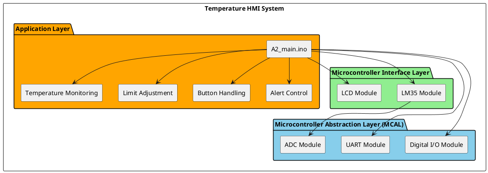
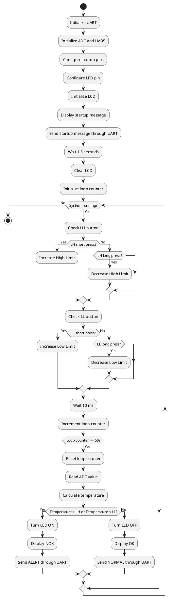
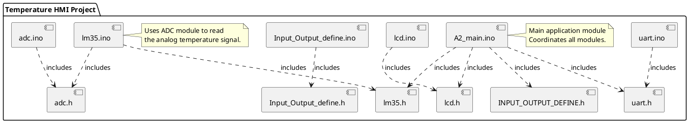

# Detailed Design Document
# Temperature Monitoring and Human Machine Interface (HMI)

| **Author** | Amr Yasser Mohamed | Omar Osama Yassin | Khaled Abdelazeem Elsayed 
|:------------------------|:-----------------------------------------------------|
| **Status** | Finished |
| **Version** | 1.0 |
| **Date** | 19/11/2026 |

## Introduction

This document describes the detailed design and implementation of a Temperature Monitoring and Human Machine Interface (HMI) system developed using the Arduino Uno microcontroller (ATmega328P) and an LM35 temperature sensor.

The system continuously measures the surrounding temperature through the Analog-to-Digital Converter (ADC) and displays the measured temperature, its status, and the configured temperature limits on a 16×2 LCD.

Two push buttons allow the user to adjust the High Limit (LH) and Low Limit (LL). A short press increases the corresponding limit, while a long press decreases it. An LED provides a visual alert whenever the measured temperature falls outside the configured range.

UART communication is also implemented to transmit temperature measurements, configured limits, and system status to the Serial Monitor.

The software is developed using native C programming and direct AVR register manipulation without relying on pre-developed Arduino libraries for the system functionalities.

### Purpose

The purpose of this document is to explain the hardware and software design of the Temperature HMI system and describe how its different modules interact to achieve the required functionality.

It provides details about the system architecture, hardware connections, software modules, ADC configuration, temperature conversion, LCD communication, button handling, and UART communication.

The document also describes the assumptions, constraints, and configuration parameters used during implementation.

### Scope

The scope of this project includes:

- Measuring temperature using an LM35 analog temperature sensor.
- Converting the analog sensor signal into a digital value using the ATmega328P ADC.
- Calculating the measured temperature in degrees Celsius.
- Displaying the temperature and configured limits on a 16×2 LCD.
- Allowing the user to increase and decrease the high and low temperature limits using two push buttons.
- Implementing software debouncing to prevent unwanted button readings.
- Supporting short-press and long-press operations.
- Activating an LED when the measured temperature is outside the configured range.
- Transmitting temperature readings, limits, and system status through UART at 9600 baud.

The system is designed to demonstrate the basic operation of an industrial Human Machine Interface (HMI), similar to a temperature monitoring interface used in a vehicle dashboard.

The current implementation uses an LED as the alert indicator. Although a buzzer is available as a hardware component, buzzer control is not implemented in the current software.

## Architectural Overview

The system is divided into three main software layers: Application, Microcontroller Interface, and Microcontroller Abstraction Layer (MCAL).

The Application layer contains the main program logic, including temperature monitoring, limit adjustment, button handling, and alert control.

The Microcontroller Interface layer contains the LCD and LM35 modules, which provide higher-level functions for interacting with the hardware.

The MCAL layer contains the low-level ADC, UART, and Digital Input/Output (DIO) modules. These modules directly configure and access the ATmega328P registers.

The overall software architecture is illustrated below.

### Assumptions & Constraints

The system is designed according to the following assumptions and constraints:

**Hardware Assumptions:**

1. The Arduino Uno operates using a 16 MHz clock frequency.
2. The microcontroller operates at 5V, and AVCC is used as the ADC voltage reference.
3. The LM35 sensor produces an output voltage proportional to temperature at a rate of 10 mV per degree Celsius.
4. The two push buttons use external pull-down resistors, meaning their input pins read LOW when released and HIGH when pressed.
5. The LCD is a standard 16×2 character LCD compatible with the HD44780 interface.
6. A potentiometer is used to adjust the LCD contrast.
7. The LED is connected to PB2 through a current-limiting resistor.

**Software Constraints:**

1. The initial high temperature limit is 30°C, and the initial low temperature limit is 20°C.
2. The high temperature limit cannot exceed 150°C.
3. The low temperature limit cannot decrease below 0°C.
4. The high temperature limit must always remain at least 1°C above the low temperature limit.
5. A short button press increases the corresponding temperature limit by 1°C.
6. A long button press decreases the corresponding temperature limit by 1°C approximately every second.
7. Button debouncing is implemented using software counters.
8. Temperature measurements are updated approximately every 500 ms.
9. UART communication is configured at 9600 baud with 8 data bits and 1 stop bit.
10. Temperature readings are displayed with one decimal place.

**System Limitations:**

- The ADC conversion assumes a 5V reference voltage. Variations in the actual supply voltage may affect measurement accuracy.
- The LM35 measurement accuracy depends on the sensor, its wiring, and the ADC reference voltage.
- The system uses a polling-based approach rather than hardware interrupts for button detection.
- The current implementation uses an LED as the alert indicator. Buzzer operation is outside the scope of the implemented software.

**Main Program Flow:**

The following flowchart illustrates the main operation of the system.

## Functional Description

This section describes the main functionalities of the Temperature HMI system and explains how each module contributes to the overall operation.

**1. Temperature Measurement**

The LM35 sensor measures the surrounding temperature and produces an analog voltage proportional to the measured temperature.

The sensor output is connected to PC0 (ADC0) of the ATmega328P. The ADC converts the analog voltage into a 10-bit digital value ranging from 0 to 1023.

The ADC result is then converted into voltage and subsequently into temperature in degrees Celsius.

**2. Temperature Limit Adjustment**

The system provides two push buttons to allow the user to configure the acceptable temperature range.

- LH Button (PB0): Controls the high temperature limit.
- LL Button (PB1): Controls the low temperature limit.

Each button supports two operations:

- Short press: Increases the corresponding limit by 1°C.
- Long press: Decreases the corresponding limit by 1°C approximately every second.

The system also applies restrictions to prevent invalid temperature ranges.

The high limit cannot exceed 150°C, and the low limit cannot go below 0°C. Additionally, the high limit must always remain at least 1°C above the low limit.

**3. Button Debouncing**

Mechanical push buttons may produce multiple rapid electrical transitions when pressed or released. This phenomenon is known as switch bouncing.

To prevent unwanted button actions, software debouncing is implemented in both button-handling functions.

The program compares the current button reading with the previous reading. If a change occurs, the debounce counter is reset.

A new button state is accepted only after the reading remains unchanged for three consecutive counter increments.

This helps prevent false detections and unwanted temperature limit changes.

**4. LCD Display**

A 16×2 character LCD is used to display the measured temperature, system status, and configured temperature limits.

The first row displays the measured temperature and its status:

- `T:XX.X OK` when the temperature is within the configured range.
- `T:XX.X NOK` when the temperature is outside the configured range.

The second row displays the configured high and low limits:

`LH:30 LL:20`

The LCD is controlled using a 4-bit communication interface, reducing the number of required data connections.

**5. Alert Indication**

The system continuously compares the measured temperature with the configured limits.

If the measured temperature exceeds the high limit or falls below the low limit, the LED connected to PB2 is activated.

If the temperature returns to the acceptable range, the LED is turned OFF.

The LCD and Serial Monitor also indicate whether the temperature is within or outside the configured range.

**6. UART Communication**

UART communication is used to transmit system information to the computer through the Arduino Uno USB connection.

The communication is configured using the following parameters:

- Baud Rate: 9600
- Data Bits: 8
- Stop Bits: 1
- Parity: None

The Serial Monitor displays startup messages, initial temperature limits, limit adjustments, temperature readings, and the current system status.

## Implementation of the Module

The project is implemented using modular programming, where each module is responsible for a specific hardware or software functionality.

The main program coordinates the different modules through their exported functions.

**1. Main Application Module**

The main application is implemented in `A2_main.ino`.

It is responsible for initializing the system, monitoring the buttons, adjusting the temperature limits, reading the temperature, controlling the LED, updating the LCD, and transmitting information through UART.

Two global variables are used to store the configured limits:

- `HighLimit`: Stores the high temperature limit and is initially set to 30°C.
- `LowLimit`: Stores the low temperature limit and is initially set to 20°C.

The main loop continuously checks the two buttons and updates the temperature measurement every 50 iterations.

A 10 ms delay is used in each loop iteration, resulting in an approximately 500 ms measurement update interval.

**2. ADC Module**

The ADC module consists of `adc.ino` and `adc.h`.

The ADC is initialized by configuring the following registers:

- `DDRC`: Configures PC0 as an input.
- `DIDR0`: Disables the digital input buffer on ADC0.
- `ADMUX`: Selects AVCC as the voltage reference.
- `ADCSRA`: Enables the ADC and configures the prescaler to 128.

The ADC conversion function selects the required ADC channel, starts the conversion, waits for completion, and reads the conversion result from `ADCL` and `ADCH`.

The ADC provides a 10-bit resolution, allowing digital readings between 0 and 1023.

**3. LM35 Module**

The LM35 module consists of `lm35.ino` and `lm35.h`.

The module initializes the ADC through `ADC_Init()` and reads the sensor using `ADC_Read(0)`.

The ADC reading is converted into voltage using:

`Voltage = (ADC_Value × 5.0) / 1023.0`

Since the LM35 produces 10 mV per degree Celsius, the temperature is calculated using:

`Temperature = Voltage × 100.0`

The resulting temperature is returned as a floating-point value.

**4. UART Module**

The UART module consists of `uart.ino` and `uart.h`.

It provides functions for initializing UART, configuring the baud rate, transmitting characters and strings, checking received data availability, and reading received characters.

The baud rate is configured using the USART baud rate register:

`UBRR = ((F_CPU / 16) / BaudRate) - 1`

The UART transmitter and receiver are enabled through `UCSR0B`, while `UCSR0C` is configured for 8-bit data transmission with one stop bit.

The main application uses the transmission functions to display system information through the Serial Monitor.

**5. LCD Module**

The LCD module consists of `lcd.ino` and `lcd.h`.

It implements direct communication with the LCD through AVR registers without using an external LCD library.

The LCD operates in 4-bit mode. The data connections use PD4–PD7, while the control connections are:

- PD2: Register Select (RS).
- PD3: Enable (E).

The module provides functions to initialize the LCD, send commands, write characters and strings, clear the display, and position the cursor.

Each 8-bit command or character is transmitted as two 4-bit nibbles.

**6. Digital Input/Output Module**

The digital input/output module consists of `Input_Output_define.ino` and `Input_Output_define.h`.

It provides a simple interface for configuring the direction of the microcontroller pins.

The `IO_SelectPin()` function selects the required port and pin, while `IO_SetPinMode()` configures the selected pin as either an input or output.

The module directly modifies the `DDRB`, `DDRC`, and `DDRD` registers using bitwise operations.

This allows individual pins to be configured without affecting the remaining pins in the same port.

**7. Button Handling Functions**

Two functions are implemented in the main application:

- `LH_ButtonPressed()`
- `LL_ButtonPressed()`

Both functions use static variables to retain button states and counters between function calls.

They return three possible values:

- `1`: A short press has been detected.
- `-1`: A long-press interval has been reached.
- `0`: No button action has been detected.

A hold counter is incremented while the button remains pressed. When it reaches 100, a long-press action is generated, corresponding to approximately one second.

A flag named `HasDecreased` prevents the button release from being interpreted as an additional short press after a long press.

**8. Display and UART Formatting Functions**

The main application also implements helper functions to display numerical values without relying on pre-developed number-conversion functions.

`LCD_WriteNumber()` converts an unsigned integer into individual digits and displays them on the LCD.

`UART_WriteNumber()` performs the same operation but transmits the digits through UART.

The `DisplayTemperature()` function formats the measured temperature to one decimal place and displays it together with the configured limits and system status.

The `SendTemperature()` function transmits the temperature, high and low limits, and the corresponding status message through UART.

## Integration and Configuration

The system is divided into multiple source and header files. Each module provides specific functions that are used by the main application or other modules.

### Static Files

The following table lists all files that form the software implementation.

| File name | Contents |
|-----------|----------|
| `A2_main.ino` | Main application. Initializes the modules, handles button operations, monitors temperature, controls the LED, and updates the LCD and UART output. |
| `uart.ino` | Implements UART initialization, baud rate configuration, character and string transmission, and data reception. |
| `uart.h` | Declares the UART functions available to other modules. |
| `adc.ino` | Implements ADC initialization, channel selection, conversion, and ADC result reading. |
| `adc.h` | Declares the ADC initialization and reading functions. |
| `lm35.ino` | Initializes the ADC and converts the LM35 analog reading into temperature in Celsius. |
| `lm35.h` | Declares the LM35 initialization and temperature reading functions. |
| `lcd.ino` | Implements LCD initialization, 4-bit communication, command transmission, character and string display, and cursor positioning. |
| `lcd.h` | Declares the LCD functions available to the main application. |
| `Input_Output_define.ino` | Implements the digital pin selection and input/output configuration functions. |
| `Input_Output_define.h` | Defines the input/output modes, port identifiers, and function declarations. |

### Include Structure

The following diagram illustrates the relationship between the source files and their corresponding header files.

### Configuration

The following table lists the main hardware and software configuration parameters used in the project.

| Name | Value / Range | Description |
|------|-------------|-------------|
| `F_CPU` | 16 MHz | Microcontroller clock frequency used for timing and UART baud rate calculation. |
| `BaudRate` | 9600 | UART communication speed. |
| `HighLimit` | Initial: 30°C, Maximum: 150°C | Configured high temperature limit. |
| `LowLimit` | Initial: 20°C, Minimum: 0°C | Configured low temperature limit. |
| `MAX_LIMIT` | 150 | Maximum permitted high temperature limit. |
| `HOLD_INTERVAL_COUNT` | 100 | Number of loop iterations required to generate a long-press action. |
| `LoopCounter` | 50 iterations | Number of main loop iterations between temperature measurements. |
| Main loop delay | 10 ms | Delay used to control the main loop timing and button monitoring. |
| Temperature update interval | Approximately 500 ms | Interval between consecutive temperature measurements. |
| ADC Resolution | 10 bits | ADC digital output range from 0 to 1023. |
| ADC Reference | AVCC (5V) | Voltage reference used by the ADC. |
| ADC Prescaler | 128 | ADC clock prescaler configuration. |
| LM35 Sensitivity | 10 mV/°C | Sensor output voltage per degree Celsius. |
| LCD Mode | 4-bit | LCD communication mode. |
| LCD Size | 16×2 | Number of characters and rows supported by the display. |
| `LH Button` | PB0 | Push button used to adjust the high temperature limit. |
| `LL Button` | PB1 | Push button used to adjust the low temperature limit. |
| `LED` | PB2 | Visual alert indicator. |
| `LM35 Output` | PC0 / ADC0 | Analog temperature sensor input. |
| LCD RS | PD2 | LCD Register Select control signal. |
| LCD Enable | PD3 | LCD Enable control signal. |
| LCD Data | PD4–PD7 | Four LCD data connections. |
| UART TX | PD1 | UART transmission pin. |
| UART RX | PD0 | UART reception pin. |

